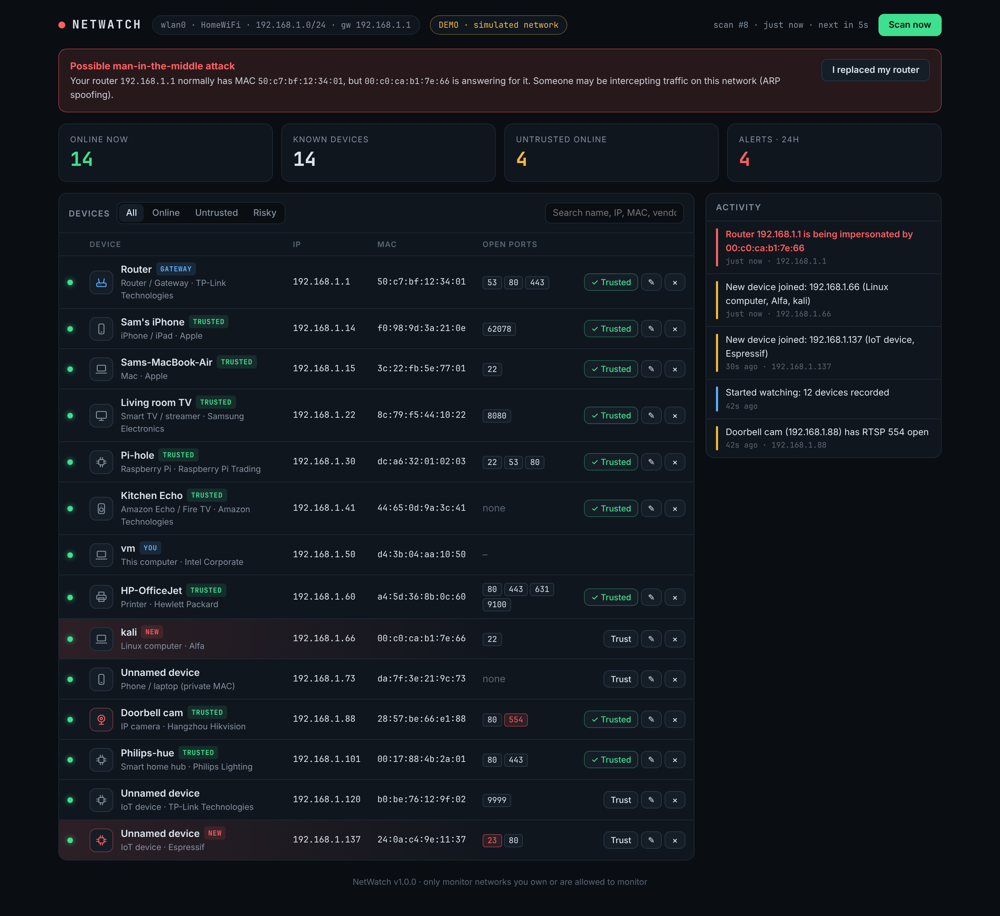

# NetWatch: home network watchdog

NetWatch watches your Wi-Fi or LAN and tells you what's on it, what each device is, and when something suspicious happens.



- **Finds every device** on your network and identifies it (phone, TV, camera, printer, smart plug…) from its MAC vendor, hostname and open ports
- **Alerts you on your phone (Telegram) and desktop** when an unknown device joins
- **Flags risky open ports**, like Telnet on a cheap IoT camera
- **Detects ARP spoofing / man-in-the-middle attacks**: if someone impersonates your router, you get a critical alert naming the attacker's MAC and IP
- **Live web dashboard** with trust, rename and forget buttons, an activity feed, and phone-friendly layout
- **Zero dependencies to install on Kali**: pure Python 3, using `arp-scan` or `scapy` (both preinstalled on Kali) when run as root

> ⚠️ Only run NetWatch on networks you own or have permission to monitor.

---

## Quick start

```bash
# 1. See it in action first (simulated network, no root needed)
python3 netwatch.py demo
#    → open http://127.0.0.1:8080 in your browser

# 2. One-off scan of your real network
sudo python3 netwatch.py scan

# 3. Watch continuously, with alerts + dashboard
sudo python3 netwatch.py monitor
#    → open http://127.0.0.1:8080
```

The first scan records a **baseline** of your current devices. After that, any device NetWatch has never seen triggers an alert. Mark your own devices as trusted (in the dashboard, or with `trust`) so you can spot strangers at a glance.

## Commands

| Command | What it does |
|---|---|
| `monitor` | Scan every 60 s, send alerts, serve the dashboard (`--interval`, `--port`, `--host`, `--no-dashboard`) |
| `scan` | Scan once and print a table (`--alert` to also send alerts) |
| `demo` | Run the dashboard on a simulated network |
| `list` / `list --all` | Show known devices without scanning |
| `events` | Show recent alerts and events |
| `trust <device> [--name "Sam's phone"]` | Mark a device as yours |
| `name <device> "Living room TV"` | Give a device a friendly name |
| `untrust <device>` / `forget <device>` | Remove trust / forget a device (it alerts as new next time) |
| `accept-gateway` | Accept a new router MAC after you replace your router |
| `telegram-setup` / `test-alert` | Connect Telegram alerts / send a test alert |

`<device>` can be a MAC, an IP or part of the device's name.
Useful scan options: `--iface wlan0`, `--subnet 192.168.1.0/24`, `--method arp-scan|scapy|kernel`, `--no-probe` (skip port checks).

## Get alerts on your phone (Telegram)

1. In Telegram, message **@BotFather** → `/newbot` → choose a name. Copy the token it gives you.
2. Run `python3 netwatch.py telegram-setup`, paste the token, then press **Start** in your new bot's chat.
3. Done. Check it with `python3 netwatch.py test-alert`.

The token is stored in `~/.config/netwatch/config.json` with `600` permissions (only you can read it).

## View the dashboard from your phone

```bash
sudo python3 netwatch.py monitor --host 0.0.0.0
```

It prints a URL with a secret token, like `http://192.168.1.50:8080/?token=…`. Open that on your phone (same Wi-Fi). Without the token the dashboard refuses access.

## Run it automatically at boot (systemd)

```bash
sudo mkdir -p /opt/netwatch && sudo cp netwatch.py /opt/netwatch/
sudo python3 /opt/netwatch/netwatch.py --data-dir /var/lib/netwatch telegram-setup   # optional
sudo tee /etc/systemd/system/netwatch.service >/dev/null <<'EOF'
[Unit]
Description=NetWatch home network watchdog
After=network-online.target
Wants=network-online.target

[Service]
ExecStart=/usr/bin/python3 /opt/netwatch/netwatch.py --no-color --data-dir /var/lib/netwatch monitor --no-desktop
Restart=on-failure

[Install]
WantedBy=multi-user.target
EOF
sudo systemctl enable --now netwatch
journalctl -u netwatch -f      # watch the log
```

---

## How it works

**Discovery.** Devices on your LAN must answer ARP ("who has 192.168.1.14?") to communicate, so an ARP sweep finds devices that ignore ping. NetWatch uses `arp-scan` or `scapy` as root. Without root it falls back to nudging the kernel to ARP every address and reading `/proc/net/arp`.

**Fingerprinting.** Each device's type is guessed from:
- the MAC vendor (from nmap's database: Apple, Espressif, Hikvision…)
- its hostname (`Galaxy-S24`, `HP-OfficeJet`…)
- a light TCP check of 22 common ports (62078 = iPhone, 554 = camera, 9100 = printer…)

Phones that use "private Wi-Fi addresses" are recognised by the locally-administered bit in their MAC.

**Man-in-the-middle detection.** On the first scan NetWatch remembers your router's MAC. On every scan after that it checks:
1. Does anyone other than the real router answer for the router's IP? (classic ARP spoofing)
2. Does **your own** ARP cache point the router IP at a different MAC? (you're being poisoned right now)
3. Is any other IP answered by two different MACs? (IP conflict or spoofing)

Alerts fire once per incident, and NetWatch tells you when things are back to normal.

**Multiple networks.** Devices and the router baseline are stored per network (Wi-Fi name + subnet). Moving your laptop between home and a café won't cause false alarms. Names and trust are per device, so your phone stays trusted everywhere.

### Test the attack detection (in your own lab)

From a **second machine you own** on the same network, ARP-spoof your Kali box, then watch NetWatch catch it:

```bash
sudo apt install dsniff
sudo arpspoof -i wlan0 -t <kali-ip> <router-ip>
```

Stop it with Ctrl+C and NetWatch reports "Router back to normal".

## Troubleshooting

- **Only 1–2 devices show up in a VM**: the VM is using NAT networking. Set the VM's network adapter to **Bridged** mode.
- **"not running as root" note**: use `sudo` for fast, accurate scans.
- **Dashboard port busy**: `--port 8081`.
- **Large networks** (bigger than /22) are limited to your /24 unless you pass `--subnet`.
- Data lives in `~/.config/netwatch/` (`netwatch.db` + `config.json`). Delete the folder to start fresh.

## Run the tests

```bash
python3 tests/test_logic.py && python3 tests/test_telegram.py
```

## Ideas to take it further

- Run it 24/7 on a Raspberry Pi as a plug-in "network guard" box
- Weekly email or Telegram report: new devices, risky ports, uptime
- Block an unknown device from the dashboard (router API, or Pi-hole for DNS)
- Detect rogue DHCP servers and evil-twin Wi-Fi networks
